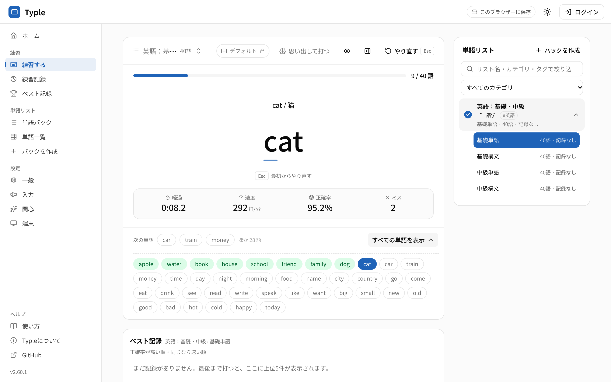
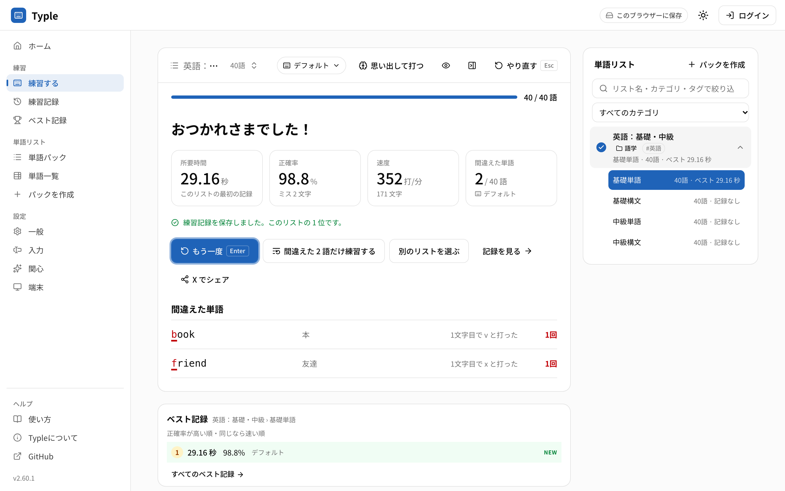
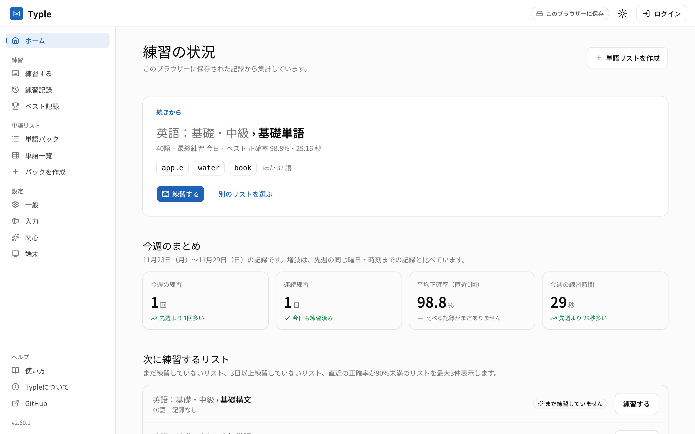
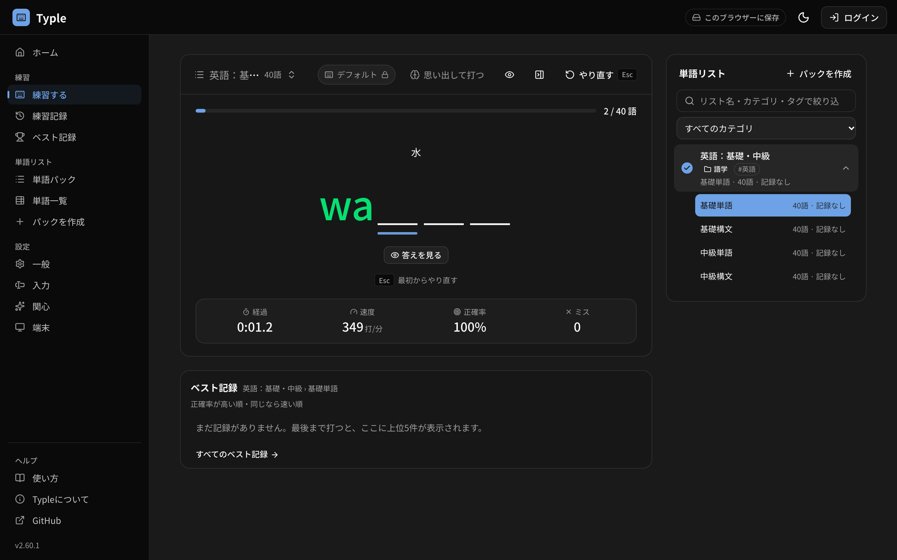
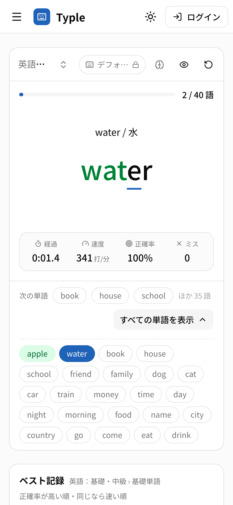

# Typle

[](https://github.com/Sparklingstadt/typle-r/actions/workflows/ci.yml)

覚えたい言葉を、打って覚えるタイピングアプリです。自分の単語リストと、269件の公式リスト（プログラミングのコマンド・構文、外国語の単語）で練習できます。ログインなしで使えます。

**本番: https://typle.sparklingstadt.com**

<p></p>

<table>
  <tr>
    <td width="50%"></td>
    <td width="50%"></td>
  </tr>
  <tr>
    <td>練習の結果と、間違えた単語</td>
    <td>ホームの集計</td>
  </tr>
  <tr>
    <td></td>
    <td align="center"></td>
  </tr>
  <tr>
    <td>答えを隠して打つ「思い出して打つ」（ダーク）</td>
    <td>スマートフォンの幅</td>
  </tr>
</table>

## できること

- **3つの練習**：見て打つ、答えを隠して意味から打つ（思い出して打つ）、手で書く（Handwriting）
- **単語リスト**：自分で作るか、公式リストをフォローします。CSV とパックのファイル（`.typle-pack.json`）で読み込み・書き出しができます
- **記録**：リストごとのベスト、今週のまとめ、間違えた単語と、その単語だけの練習
- **保存**：ログインなしではブラウザーに、ログイン（Sparklingstadt ID・GitHub）するとアカウントに保存します
- **デモアカウント**：アカウントがなくても、ログイン画面の「デモアカウントで試す」で、見本のリストと1週間分の記録が入った共有のアカウントを試せます。毎日 4:00（日本時間）に見本へ戻ります
- **簡易入力**：é を e、ш を sh、ß を ss のように、アクセントやキリル文字をふつうのキーで打てます
- **表示**：6言語（日本語・英語・フランス語・ロシア語・中国語の簡体字と繁体字）、ライトとダーク、スマートフォンの幅

画面ごとの仕様は [docs/features.md](docs/features.md) にあります。

## 技術

| 分野 | 使っているもの |
|---|---|
| 画面 | Next.js 16（App Router）・React 19・TypeScript（strict）・Tailwind CSS 4・shadcn/ui（Radix）・next-intl |
| API と DB | Next.js の Route Handler・PostgreSQL（Prisma Client で読み書き）・SQL のマイグレーション |
| ログイン | Better Auth（OpenID Connect・GitHub OAuth・共有のデモアカウント）。セッションは DB に持ち、Cookie に最大5分キャッシュします |
| 手書きの読み取り | onnxruntime-web と PaddleOCR の韓国語のモデル。サーバーに送らず、ブラウザーの中で読みます |
| テスト | node:test（単体と、実際の DB を使う API）・Playwright（E2E・スクリーンショット・ARIA スナップショット） |
| 運用 | Vercel（シンガポール）と Neon。AWS へ移す準備として Dockerfile と AWS CDK（`infra/`） |

## 設計で工夫したところ

### 1. 同時の保存で、データを失わない

- 単語リストの保存は `revision` を付けて送り、サーバーは `UPDATE ... WHERE revision = $2` の1文で照合と書き込みをします。ほかのタブや端末が先に保存していたら 409 を返し、画面は最新を読み直します。
- 練習の記録は `revision` を使いません。行をロックして1件ずつ足すので、リストを編集している間に終えた練習も、競合で断られません。同じ記録をもう一度送っても増えません。
- 画面の側は、保存を同時に1つしか送らず、アカウントを切り替えたあとに届いた結果は表示しません。

コード：[src/server/workspace.ts](src/server/workspace.ts)・[src/lib/workspaceSession.ts](src/lib/workspaceSession.ts)

### 2. 入力の判定を、画面から切り離す

- 判定は React に依存しない関数です。今の状態と打った文字から、次の状態を返します。経過時間・速度・正確率も同じところで計算します。
- 日本語やピンインの変換中の文字は判定せず、確定した文字だけを比べます。
- キリル文字1字を複数のキー（ш を sh、щ を shch）で打つ途中の状態も、ここで持ちます。

コード：[src/lib/typing.ts](src/lib/typing.ts)（テストは [tests/typing.test.cjs](tests/typing.test.cjs)）

### 3. 画面は保存先を知らない

- 画面は `useWordLists()` からリストと保存の操作を受け取るだけです。ブラウザー（LocalStorage）とアカウント（API）のどちらに保存するかは、ログインの状態で決まります。
- 画面から保存先（`src/lib/storage`）やサーバーのコード（`src/server`）を import すると、ESLint がエラーにします（[eslint.config.mjs](eslint.config.mjs)）。

### 4. 本番に近い形でテストする

- E2E（約330件）は、本番ビルドの `next start` と実際の PostgreSQL を通します。作成・編集・練習・削除のほか、アカウントの分離と 401・403・409 の応答も確かめます。
- Sparklingstadt ID のログインは、テストが起動する偽の OpenID Connect のサーバーを相手に、最後まで通します。
- スクリーンショットは時計を止めて撮るので、経過時間や「今日」の見出しまで毎回同じ画像になります。ARIA スナップショットで、役割と名前の並びも比べます。
- 単体テスト（約700件）は、判定・集計・形式の検証と、DB を使う API を確かめます。

手順と中身：[docs/development.md](docs/development.md)・[docs/snapshots.md](docs/snapshots.md)

### ほかに

- 同じ API を Go・Kotlin（Ktor）・Rails でも実装し、Next.js と速度を比べました。その実装は [typle-backends](https://github.com/Sparklingstadt/typle-backends) に分けてあります（v2.60.5 から）。このリポジトリにあるのは Next.js だけです。
- ページごとの nonce を使う Content-Security-Policy を送っています。今は報告だけで、まだ止めていません（[docs/architecture.md](docs/architecture.md)）。
- 機能ごとの設計書を [docs/superpowers/specs](docs/superpowers/specs) に、これからの順番と「やらないこと」を [docs/roadmap.md](docs/roadmap.md) に残しています。

## 開発の進め方

- 1つの PR に1つの項目を入れ、PR ごとにバージョンを上げます。
- 順序は「PR → CI → マージ → main の CI（検査 → GitHub Release → 本番デプロイ → 本番の確認）」です（[docs/release-workflow.md](docs/release-workflow.md)）。マージすると、そのまま本番に公開されます。
- `npm run verify` は、マイグレーション・型チェック・単体テスト・Lint・knip・本番ビルド・AWS CDK の検査・E2E・API の文書のビルドを順に流し、最初の失敗で止まります。
- GitHub Actions が、PR と main で同じ `npm run verify` を流し、main では Release とデプロイまで行います（[ci.yml](.github/workflows/ci.yml)）。macOS で撮ったスクリーンショットとの比較だけは、PR の前に手元で行います。

## 手元で動かす

Node.js 24 と Docker Compose を使います。

```sh
npm ci
node scripts/setup-local.cjs
docker compose --env-file .env.local up -d --wait
npm run db:migrate
npm run dev
```

http://localhost:3000 を開きます。GitHub のログインや開発用のログインの設定、LAN 内の別の端末から使う方法は [docs/development.md](docs/development.md) にあります。

## コードの構成

| 場所 | 内容 |
|---|---|
| `src/app` | ページ・レイアウト・Route Handler（App Router） |
| `src/components` | UI のコンポーネント（`ui/` は shadcn/ui） |
| `src/hooks` | React のフック。`useWordLists` が画面にリストと保存の操作を渡します |
| `src/lib` | フック以外の処理。入力の判定・記録・集計・検証、保存先（`storage/`）、公式リスト（`packs/`） |
| `src/i18n`・`src/messages` | 多言語化（next-intl）と各言語の文言 |
| `src/proxy.ts` | ページごとの nonce と CSP |
| `src/server` | Route Handler が使うサーバーのコード（DB・ログイン・保存） |
| `prisma/schema.prisma` | DB のテーブルの形。Prisma Client（`src/generated/prisma`。`npm install` と `npm run build` で作られ、git には入れない）の元 |
| `db/migrations` | SQL のマイグレーション |
| `tests` | 単体テスト（`*.test.cjs`）と E2E（`e2e/`） |
| `infra` | AWS CDK（移行の準備） |

くわしい説明は [docs/architecture.md](docs/architecture.md) にあります。

## 文書

| 文書 | 内容 |
|---|---|
| [docs/features.md](docs/features.md) | 画面ごとの機能の仕様 |
| [docs/development.md](docs/development.md) | 手元で動かす手順と、検査（`npm run verify`）の中身 |
| [docs/architecture.md](docs/architecture.md) | コードの構成、ログイン、保存とアクセス制御 |
| [docs/production.md](docs/production.md) | 本番（Vercel・Neon）の構成、コンテナのイメージ、なくした機能の扱い |
| [docs/release-workflow.md](docs/release-workflow.md) | PR から本番公開までの手順 |
| [docs/snapshots.md](docs/snapshots.md) | スナップショットテスト（スクリーンショット・ARIA）の見分け方と更新 |
| [docs/roadmap.md](docs/roadmap.md) | これからの進め方（今・次・その先の順番と理由） |
| [docs/refactoring-roadmap.md](docs/refactoring-roadmap.md) | リファクタリングのロードマップ |
| [docs/design/](docs/design) | 画面ごとのデザインレビュー |
| [docs/word-list-sources.md](docs/word-list-sources.md) | 公式の単語リストの出典と検証 |
| [api-docs/](api-docs/src/README.md) | アプリの API の仕様（VuePress。`cd api-docs && npm ci && npm run docs:dev`） |
| [docs/aws/](docs/aws/README.md) | AWS の練習環境を作って消す手順書と、本番を CDK で作る手順（[production.md](docs/aws/production.md)） |
| [CHANGELOG.md](CHANGELOG.md) | バージョンごとの変更（v2.1.3 まで。以降は [GitHub Releases](https://github.com/Sparklingstadt/typle-r/releases)） |

## 関連リポジトリ

| リポジトリ | 内容 |
|---|---|
| typle-r（このリポジトリ） | Web 版と、そのバックエンドの API（どちらも Next.js。API は `src/app/api`・`src/server`） |
| [typle-ipad](https://github.com/Sparklingstadt/typle-ipad) | iPad 版と Mac 版（SwiftUI）。同じコードを1つのプロジェクトでビルドします |
| [typle-macos](https://github.com/Sparklingstadt/typle-macos)（旧 typle-m） | Mac 版。v2.6.11 で typle-ipad にまとめてアーカイブしました |
| [typle-w](https://github.com/Sparklingstadt/typle-w) | Windows 11 版（C#・WinUI 3）。v2.6.9 でアーカイブし、開発を止めました |
| [typle-a](https://github.com/Sparklingstadt/typle-a) | Android タブレット版（Kotlin・Jetpack Compose）。v2.6.9 でアーカイブし、開発を止めました |
| [typle-backends](https://github.com/Sparklingstadt/typle-backends) | 同じ API の Go・Kotlin（Ktor）・Rails の実装と、Next.js との速度比較。v2.60.5 でこのリポジトリから分けました |
| [typle-kotlin-backend](https://github.com/Sparklingstadt/typle-kotlin-backend) | 以前の Go のバックエンドと同じ API の Kotlin（Ktor）版。v2.6.10 でアーカイブし、`TYPLE_BACKEND=kotlin` の切り替えも外しました |

合わせて直すものの一覧は [docs/architecture.md](docs/architecture.md) の「関連リポジトリとの合わせ方」にあります。

## ライセンス

コードは MIT ライセンスです（[LICENSE](LICENSE)）。次のものは対象外です。

- 公式の単語リスト（`src/lib/packs/commands`）。出典は [docs/word-list-sources.md](docs/word-list-sources.md) にあります。
- 手書きの認識モデル（`public/handwriting`）。Apache License 2.0 で、出典は [public/handwriting/README.md](public/handwriting/README.md) にあります。

依存パッケージのライセンスは、アプリの「Typleについて」→「オープンソースのライセンス」で見られます。

## リポジトリの経緯

`liyur-qie/typle-r` の履歴を保持した独立したコピーです。2026年11月から公開しています。
